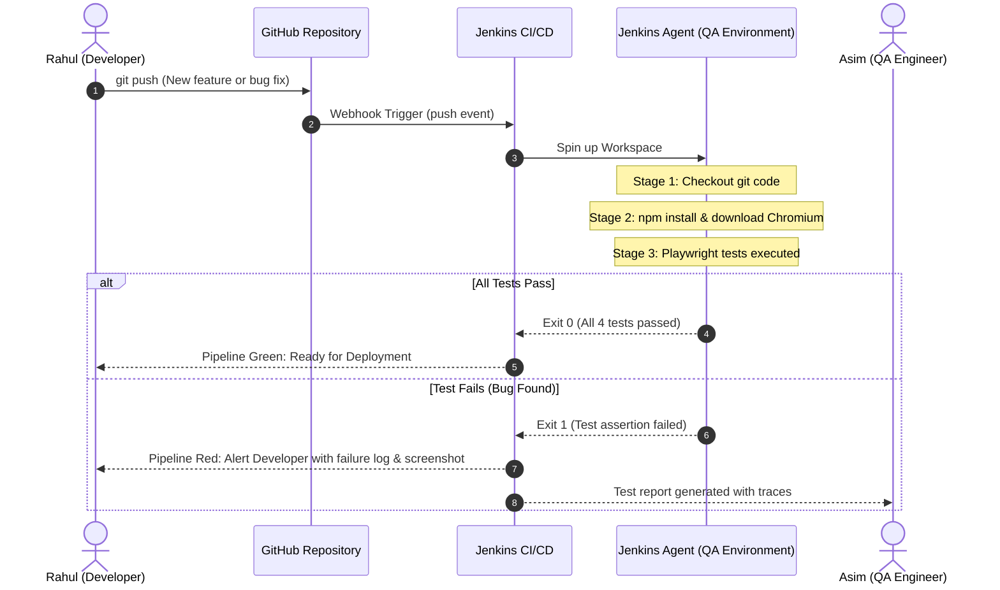

# 🛒 Shopping App — Jenkins CI/CD & Playwright Automation Lab

> **A real-world project demonstrating how Developer code and QA Automation tests interact through Jenkins and GitHub.**

---

## 📖 The Story & Team Roles

| Persona | Role | Responsibility |
| :--- | :--- | :--- |
| **Rahul** | Developer | Builds application features (`src/server.js`, `src/public/*`) |
| **Asim** | QA Automation Engineer | Writes and maintains end-to-end test suites (`tests/login.spec.ts`) |
| **Jenkins** | CI/CD Orchestrator | Pulls changes from GitHub, prepares the test environment, executes tests, and reports results |
| **GitHub** | Source Control | Stores code, maintains history, and notifies Jenkins via webhooks |

---

## 🏗️ Architecture & Pipeline Flow



---

## 📁 Repository Structure

```text
shopping-app-jenkins-demo/
├── Jenkinsfile              # Declarative pipeline instructions for Jenkins
├── Jenkinsfile.docker       # Alternative Docker container-based pipeline
├── Dockerfile               # Pre-configured Playwright container environment
├── playwright.config.ts     # Playwright config (JUnit & HTML reporters, WebServer)
├── package.json             # NPM dependencies and runner scripts
├── src/
│   ├── server.js            # Express backend & simulated bug toggle
│   └── public/
│       ├── index.html       # Shopping app login and product dashboard
│       ├── styles.css       # Modern UI styling
│       └── app.js           # Frontend authentication & validation logic
└── tests/
    └── login.spec.ts        # Automated E2E test suite (4 test cases)
```

---

## 🧪 Test Cases Implemented

The Playwright suite in [`tests/login.spec.ts`](file:///Users/asimgope/.gemini/antigravity-ide/scratch/shopping-app-jenkins-demo/tests/login.spec.ts) validates:

1. **Test 1: Login heading is visible** — Confirms that the login card and heading are rendered on page load.
2. **Test 2: Valid login works** — Uses valid credentials (`rahul@company.com` / `Password123!`), asserts redirect to the authenticated dashboard, and verifies welcome message.
3. **Test 3: Incorrect password is rejected** — Attempts bad password, asserts that error alert banner is displayed with message: `"Invalid username or password"`.
4. **Test 4: Empty form validation** — Submits empty credentials and asserts validation alert: `"Please enter both email and password."`.

---

## 🚀 Running Locally

### 1. Developer Mode (Run the Shopping App)
```bash
# Start the web app on port 3000
npm start
```
Visit: **http://localhost:3000** in your browser.

### 2. QA Automation Mode (Run Playwright Tests)
```bash
# Run headless tests (same as Jenkins)
npm test

# Run tests with visible browser
npm run test:headed

# Open interactive Playwright UI Runner
npm run test:ui

# View rich HTML test report
npm run test:report
```

### 3. Simulate Rahul's Bug (Chapter 6 Scenario)
To see how Jenkins and Playwright detect bugs automatically when Rahul accidentally breaks the authentication service:
```bash
BREAK_LOGIN=true npm test
```
*Result:* Playwright captures screenshots, videos, and stack traces of the failure, and exits with code 1.

---

## 🌐 How to Deploy to GitHub

### Step 1: Initialize Git in this directory
```bash
cd shopping-app-jenkins-demo
git init
git add .
git commit -m "feat: initial shopping app with playwright tests and jenkinsfile"
git branch -M main
```

### Step 2: Create a GitHub Repository
1. Go to [github.com/new](https://github.com/new).
2. Name the repository: `shopping-app-jenkins-demo`.
3. Keep it **Public** (or Private if you have Jenkins credentials configured).
4. Do **not** initialize with README (we already have one).

### Step 3: Link and Push
```bash
git remote add origin https://github.com/<YOUR_GITHUB_USERNAME>/shopping-app-jenkins-demo.git
git push -u origin main
```

---

## ⚙️ How to Configure Jenkins Pipeline

### 1. Create the Jenkins Job
1. Open your Jenkins Dashboard.
2. Click **New Item** -> Enter `shopping-app-pipeline` -> Select **Pipeline** -> Click **OK**.
3. Under **Pipeline Definition**, select **Pipeline script from SCM**.
4. Choose **SCM**: `Git`.
5. Enter **Repository URL**: `https://github.com/<YOUR_GITHUB_USERNAME>/shopping-app-jenkins-demo.git`.
6. Branch Specifier: `*/main`.
7. Script Path: `Jenkinsfile`.
8. Click **Save**.

### 2. Configure Automated GitHub Webhook Trigger
1. In your GitHub repository: Go to **Settings** -> **Webhooks** -> **Add webhook**.
2. **Payload URL**: `http://<YOUR_JENKINS_SERVER_IP>:8080/github-webhook/`
3. **Content type**: `application/json`.
4. Which events? Select **Just the push event**.
5. Click **Add webhook**.

*Whenever Rahul pushes new code, GitHub automatically pings Jenkins to run the pipeline!*

---

## 📊 Understanding the Jenkins Stages

| Stage | What Jenkins Does | What the Tester Sees |
| :--- | :--- | :--- |
| **1. Checkout** | Clones code from GitHub into agent workspace | Confirms commit hash and branch |
| **2. Install** | Runs `npm ci` & `npx playwright install chromium` | Installs browser binaries and packages |
| **3. Execute Tests** | Launches Playwright (`npm test`) | Executes headless tests against local server |
| **4. Collect Results** | Parses `test-results/results.xml` & archives `playwright-report/` | Interactive JUnit charts, screenshots, and pass/fail badges |
